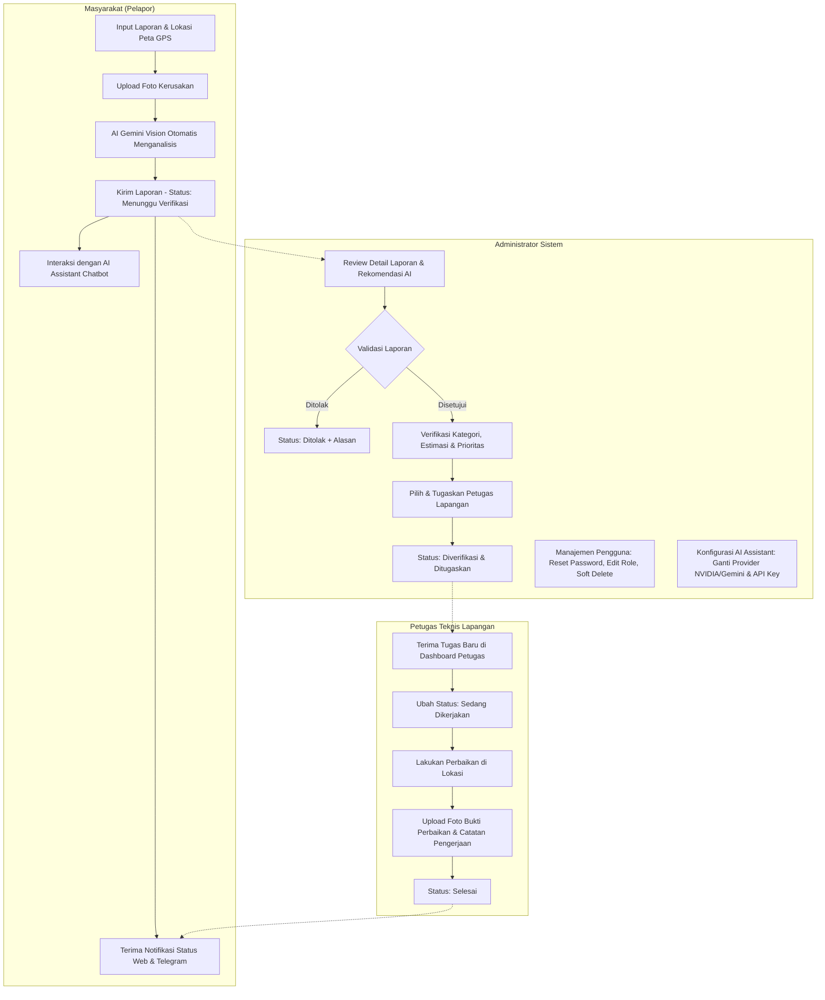

# LaporFasilitas

> **Platform Digital Pelaporan dan Monitoring Fasilitas Publik Berbasis Artificial Intelligence & Multi-Role Architecture**

---

## 📌 Identitas Pengembang & Proyek

- **Nama Mahasiswa:** Ade Febrian
- **NIM:** 41257081
- **Kelompok:** RPL-01
- **Tema:** Smart City & Civic Technology
- **Topik Kelompok:** Sistem Pelaporan dan Monitoring Fasilitas Umum Berbasis Artificial Intelligence

---

## 🎬 Tautan Video Demonstrasi

- **Video Final Demo:** [MASUKKAN LINK VIDEO DEMO]

---

## 📖 Daftar Isi

1. [Latar Belakang & Permasalahan](#-latar-belakang--permasalahan)
2. [Deskripsi & Alur Kerja Sistem](#-deskripsi--alur-kerja-sistem)
3. [Fitur Utama Aplikasi](#-fitur-utama-aplikasi)
4. [Integrasi Artificial Intelligence (AI)](#-integrasi-artificial-intelligence-ai)
5. [Integrasi Notifikasi & Telegram Bot](#-integrasi-notifikasi--telegram-bot)
6. [Teknologi yang Digunakan (Tech Stack)](#-teknologi-yang-digunakan-tech-stack)
7. [Struktur Direktori Proyek](#-struktur-direktori-proyek)
8. [Persyaratan Sistem (Prerequisites)](#-persyaratan-sistem-prerequisites)
9. [Panduan Instalasi & Konfigurasi](#-panduan-instalasi--konfigurasi)
10. [Akun Pengujian (Testing Accounts)](#-akun-pengujian-testing-accounts)
11. [Pengujian Otomatis (Automated Testing)](#-pengujian-otomatis-automated-testing)
12. [Lisensi & Kontribusi](#-lisensi--kontribusi)

---

## 🏙️ Latar Belakang & Permasalahan

Kerusakan fasilitas publik—seperti jalan berlubang, lampu penerangan jalan umum (PJU) mati, saluran air tersumbat, dan kerusakan fasilitas taman—sering kali terlambat ditangani akibat alur birokrasi manual yang lambat dan terfragmentasi.

### Permasalahan yang Dihadapi:
1. **Saluran Pelaporan Tradisional Tidak Efisien:** Warga kesulitan mengetahui ke mana harus mengadu dan sering kali aduan hilang di birokrasi tanpa kejelasan.
2. **Ketiadaan Validasi Cepat:** Petugas administrasi kewalahan memvalidasi foto kerusakan dan mengkategorikan prioritas laporan secara manual.
3. **Kurangnya Transparansi Progres:** Pelapor tidak mendapatkan pembaruan status pengerjaan secara berkala (*real-time tracking*).
4. **Koordinasi Lapangan Rendah:** Disposisi penugasan ke petugas teknis sering tidak terdata rapi beserta bukti penyelesaian di lapangan (*proof-of-work*).

### Solusi Melalui LaporFasilitas:
LaporFasilitas hadir sebagai platform *civic-tech* berbasis web yang mengintegrasikan kecerdasan buatan (*Artificial Intelligence*) untuk verifikasi dan klasifikasi kerusakan secara otomatis, koordinasi penugasan petugas berbasis peran (*Role-Based Access Control*), notifikasi instan melalui web dan Telegram Bot, serta asisten AI interaktif untuk transparansi data publik.

---

## 🔄 Deskripsi & Alur Kerja Sistem

Aplikasi ini mengadopsi arsitektur **Model-View-Controller (MVC) Native PHP** yang dirancang modular dengan pemisahan peran yang tegas (*Role-Based Access Control*):



### Hak Akses Pengguna (3 Aktor):
1. **Masyarakat (Citizen):**
   - Melaporkan keluhan fasilitas dengan foto bukti dan titik koordinat interaktif (Leaflet.js & OpenStreetMap).
   - Melihat histori laporan pribadi, timeline penanganan, dan foto bukti perbaikan.
   - Menghubungkan akun ke Telegram Bot via pairing deep-link token untuk notifikasi langsung di ponsel.
   - Menggunakan chatbot asisten untuk menanyakan status laporan dan panduan pelaporan.
2. **Administrator:**
   - Mengelola dan memvalidasi seluruh laporan masuk.
   - Menetapkan tingkat prioritas, kategori, estimasi waktu, dan disposisi penugasan kepada petugas.
   - Mengelola data pengguna (Masyarakat, Petugas, Admin) dengan fitur ubah profil, ganti role, reset password, dan status aktif/nonaktif (*soft delete*).
   - Mengatur konfigurasi AI Assistant (NVIDIA NIM vs Google Gemini, API Key terenkripsi AES-256, model, parameter suhu/token, dan tes koneksi langsung dari dashboard).
3. **Petugas Lapangan (Officer):**
   - Melihat daftar tugas perbaikan yang didelegasikan oleh Admin.
   - Memperbarui progres kerja dari status *Ditugaskan* menjadi *Sedang Dikerjakan*.
   - Menyelesaikan tugas dengan mengunggah foto bukti fisik perbaikan (*repair proof*) beserta catatan teknis pekerjaan.

---

## ✨ Fitur Utama Aplikasi

### 1. Pelaporan Fasilitas & Pemetaan Interaktif
- Form pelaporan responsif dengan upload gambar dan kompresi/validasi MIME-type aman.
- Integrasi **Leaflet.js & OpenStreetMap (OSM)** untuk penandaan koordinat latitude & longitude secara presisi langsung di peta.

### 2. Validasi & Rekomendasi Kerusakan Berbasis AI
- Pengecekan visual otomatis terhadap foto laporan menggunakan **Google Gemini Vision API**.
- Memberikan saran kategori kerusakan (Infrastruktur Jalan, Penerangan, Kebersihan, dsb.), tingkat keparahan (*Rendah, Sedang, Tinggi, Darurat*), serta estimasi ringkasan perbaikan.

### 3. Manajemen Penugasan & Timeline Transparan
- Pencatatan riwayat setiap perubahan status dalam tabel audit riwayat (`report_timelines`).
- Modul dokumentasi pengerjaan petugas dengan upload foto hasil perbaikan sebelum laporan dinyatakan selesai.

### 4. Manajemen Pengguna Menyeluruh (Admin)
- Admin dapat melihat daftar seluruh pengguna terdaftar (Masyarakat, Petugas, Admin).
- Fitur pencarian pengguna berdasarkan nama dan email.
- Ubah informasi nama, email, dan peran (*role escalation/demotion*).
- Fitur **Reset Password** aman oleh administrator.
- Fitur **Aktivasi / Deaktivasi Akun (Soft Delete)**: Akun yang dinonaktifkan tidak dapat login, namun seluruh riwayat laporan dan penugasan historis tetap utuh dan aman di database.
- Admin dapat mengedit profil akunnya sendiri secara mandiri.

### 5. Sistem Notifikasi Ganda (In-App & Telegram Bot)
- Notifikasi internal pada navbar website dengan badge hitungan belum dibaca (*unread count*).
- Integrasi bot Telegram dengan arsitektur **Outbox Pattern** untuk keandalan pengiriman pesan di latar belakang tanpa menghambat performa request HTTP utama.
- Fitur pairing instan akun warga menggunakan bot link dengan token acak berkadaluwarsa (aman dari *hijacking*).

### 6. AI Assistant Chatbot Cerdas
- Chatbot interaktif yang mengenali identitas pengguna login (*personalized assistant*).
- Memahami struktur database relasional secara *context-aware*:
  - **Masyarakat:** Dapat menanyakan status laporan miliknya, ringkasan aduan aktif, dan panduan pelaporan (privasi terisolasi).
  - **Petugas:** Dapat menanyakan tugas aktif yang sedang ditugaskan kepadanya.
  - **Admin:** Memiliki akses analitik sistem, termasuk statistik keseluruhan, rincian per role, dan daftar nama anggota terdaftar.
- Proteksi keamanan RBAC: Chatbot menolak memberikan data rahasia/laporan pengguna lain kepada pelapor biasa.

### 7. Panel Konfigurasi AI Assistant (Multi-Provider)
- Panel kontrol khusus Admin di `/admin/konfigurasi-ai`.
- Mendukung multi-provider: **NVIDIA NIM** (Llama 3.1 70B/8B Instruct) dan **Google Gemini** (Gemini 1.5 Flash / Pro).
- Penyimpanan API Key aman menggunakan enkripsi dua arah **AES-256-CBC**.
- Pengaturan model, suhu (*temperature*), batas token (*max tokens*), dan tombol **Uji Koneksi** real-time sebelum konfigurasi diaktifkan.

---

## 🤖 Integrasi Artificial Intelligence (AI)

Aplikasi ini menggunakan pendekatan AI hibrida yang terbagi menjadi dua ranah utama:

| Modul AI | Provider / Model | Lokasi Kode | Fungsi Utama |
|---|---|---|---|
| **Analisis Foto Kerusakan** | Google Gemini Vision (REST API) | `src/Services/AIService.php` | Menganalisis gambar kerusakan fasilitas publik yang diunggah warga, memvalidasi keaslian laporan, dan menyarankan kategori serta tingkat keparahan kepada admin. |
| **AI Assistant (Chatbot)** | **Multi-Provider Adapter:**<br>• NVIDIA NIM (`meta/llama-3.1-70b-instruct`)<br>• Google Gemini (`gemini-1.5-flash`) | `src/Services/AI/`<br>`src/Services/ChatbotService.php` | Asisten virtual berbasis Adapter Pattern yang menyerap data relasional database secara deterministik dan merespons pertanyaan pengguna secara kontekstual sesuai role login. |
| **Pengelolaan Konfigurasi AI** | Database Driven (`ai_configurations`) | `src/Controllers/AdminAIConfigController.php` | Antarmuka dashboard admin untuk mengganti provider aktif, mengelola API Key terenkripsi AES-256, dan menyesuaikan parameter inferensi tanpa ubah kode sumber. |

---

## 📲 Integrasi Notifikasi & Telegram Bot

LaporFasilitas mengadopsi pola arsitektur **Transactional Outbox** untuk memastikan keandalan pengiriman notifikasi Telegram:

1. **Pemicu Kejadian:** Saat status laporan berubah atau ada penugasan baru, sistem menyimpan pesan ke tabel `telegram_deliveries` dengan status `pending`.
2. **Pengiriman Asinkron (CLI Worker):** Worker latar belakang (`src/Commands/TelegramWorkerCommand.php`) secara berkala mengambil antrean pesan, mengirimkan via Telegram Bot API, dan memperbarui status menjadi `sent` (atau `failed` dengan pelacakan *retry*).
3. **Mekanisme Pairing Aman:** Warga cukup mengklik tombol *Hubungkan ke Telegram* di menu profil, yang akan membuka link bot dengan format `/start link_<token>`. Sistem memvalidasi token dan mengaitkan `chat_id` secara instan.

---

## 💻 Teknologi yang Digunakan (Tech Stack)

### Backend
- **Bahasa Pemrograman:** PHP 8.2 (Native Object-Oriented Programming & MVC Pattern)
- **Database Engine:** MariaDB / MySQL (InnoEngine dengan Foreign Key Constraints)
- **Abstraksi Database:** PHP Data Objects (PDO) dengan *Prepared Statements* (Bebas SQL Injection)
- **Keamanan:** CSRF Token Validation, Bcrypt Password Hashing (`PASSWORD_BCRYPT`), Session Regeneration, dan AES-256-CBC Encryption untuk kredensial AI.

### Frontend
- **Markup & Styling:** HTML5, CSS3 Custom Design System (CSS Custom Properties / Variables, Responsive Grid & Flexbox)
- **Interaktivitas:** Vanilla JavaScript (ES6+ Modern JS, Async/Await Fetch API)
- **Peta & Geospasial:** Leaflet.js v1.9 + OpenStreetMap Tile Server
- **Ikonografi:** FontAwesome 6 (SVG & Web Fonts)

### Layanan & Integrasi Eksternal
- **AI Vision:** Google Generative Language API (Gemini Vision)
- **AI Large Language Models (LLM):** NVIDIA NIM OpenAI-Compatible API & Google Gemini Generative AI API
- **Pesan Instan:** Telegram Bot API (HTTP Client via cURL)

---

## 📁 Struktur Direktori Proyek

```text
projekfasilitas/
├── .env.example                       # Template konfigurasi environment aplikasi
├── .gitignore                          # Daftar file yang diabaikan oleh Git
├── .htaccess                           # Pengalihan URL rewrite Apache
├── README.md                           # Dokumentasi resmi proyek
├── public/                             # Document Root Web Server
│   ├── .htaccess                       # Routing engine ke index.php
│   ├── index.php                       # Front Controller / Entry point aplikasi
│   ├── css/                            # File stylesheet kustom & tema modern
│   ├── js/                             # Logika interaktif frontend & peta Leaflet
│   └── uploads/                        # Direktori penyimpanan bukti foto laporan & perbaikan
├── src/                                # Source Code Backend (PHP MVC Core)
│   ├── bootstrap.php                   # Autoloader, helper fungsi, session, & env loader
│   ├── Database.php                    # Singleton PDO Database Connection Wrapper
│   ├── Router.php                      # Routing handler berbasis HTTP Method & URI
│   ├── backup_database.php             # Skrip backup database otomatis
│   ├── Commands/                       # Skrip CLI / Background Worker
│   │   ├── FetchAdminChatId.php        # CLI pembantu pendeteksi Chat ID admin Telegram
│   │   └── TelegramWorkerCommand.php   # CLI Outbox Worker pengirim antrean pesan Telegram
│   ├── Controllers/                    # Controller penangan request HTTP
│   │   ├── AdminAIConfigController.php # Controller panel konfigurasi AI provider
│   │   ├── AdminController.php         # Controller dashboard admin, laporan, & user
│   │   ├── AuthController.php          # Controller autentikasi login & registrasi
│   │   ├── ChatController.php          # Controller API chatbot asisten
│   │   ├── NotificationController.php  # Controller notifikasi in-app
│   │   ├── OfficerController.php       # Controller dashboard & tugas petugas
│   │   ├── ReportController.php        # Controller pembuatan & detail laporan warga
│   │   ├── TelegramPairingController.php # Controller verifikasi pairing Telegram warga
│   │   └── TelegramWebhookController.php # Controller penerima webhook Telegram
│   ├── Models/                         # Data Access Object / Database Model
│   │   ├── AIConfiguration.php         # Model konfigurasi AI provider & enkripsi key
│   │   ├── Assignment.php              # Model penugasan petugas
│   │   ├── Notification.php            # Model notifikasi in-app
│   │   ├── Officer.php                 # Model data profil petugas
│   │   ├── RepairProof.php             # Model bukti pengerjaan perbaikan
│   │   ├── Report.php                  # Model data laporan fasilitas & peta
│   │   ├── ReportTimeline.php          # Model histori perubahan status laporan
│   │   ├── TelegramDelivery.php        # Model antrean outbox Telegram
│   │   ├── TelegramPairing.php         # Model token dan status pairing Telegram
│   │   └── User.php                    # Model pengguna & manajemen akun
│   ├── Services/                       # Service Layer (Business Logic & Integrasi)
│   │   ├── AI/                         # Modul Multi-Provider Adapter AI
│   │   │   ├── AIProviderInterface.php # Kontrak interface provider AI
│   │   │   ├── AIProviderManager.php   # Factory & manager pemilihan provider aktif
│   │   │   ├── GeminiProviderAdapter.php # Adapter client Google Gemini API
│   │   │   └── NvidiaProviderAdapter.php # Adapter client NVIDIA NIM API
│   │   ├── AIService.php               # Service analisis foto kerusakan (Gemini Vision)
│   │   ├── ChatbotService.php          # Service logika chatbot & query DB kontekstual
│   │   ├── NotificationService.php     # Service orkestrasi notifikasi sistem
│   │   ├── TelegramService.php         # Service pengiriman antrean Telegram
│   │   └── UploadService.php           # Service validasi & penyimpanan upload file
│   └── [Skrip Migrasi Database]/      # Skrip migrasi terstruktur (PHP Native)
│       ├── migrate.php                 # Migrasi skema dasar tabel aplikasi
│       ├── migrate_timelines.php       # Migrasi tabel riwayat progres laporan
│       ├── migrate_notifications.php   # Migrasi tabel notifikasi in-app
│       ├── migrate_indexes.php         # Optimasi indeks performa query
│       ├── migrate_telegram_system.php # Migrasi tabel outbox & pairing Telegram
│       ├── migrate_user_status.php     # Migrasi kolom status aktif/nonaktif user
│       └── migrate_ai_config.php       # Migrasi tabel konfigurasi provider AI
├── tests/                              # Automated Test Suite (Integration & Unit Tests)
│   ├── run_all_tests.php               # Test runner eksekutor seluruh suite
│   ├── AIConfigurationTest.php         # Pengujian konfigurasi AI & enkripsi AES
│   ├── AuthAndRBACTest.php             # Pengujian autentikasi, session, & akses role
│   ├── ChatbotDatabaseTest.php         # Pengujian chatbot context database & privasi
│   ├── CitizenFeaturesTest.php         # Pengujian alur kerja warga
│   ├── CreateReportFeatureTest.php     # Pengujian pembuatan laporan & upload foto
│   ├── TelegramIntegrationTest.php     # Pengujian integrasi Telegram & pairing token
│   ├── TelegramWorkerTest.php          # Pengujian antrean outbox worker
│   └── UserManagementTest.php          # Pengujian manajemen user, soft delete, & reset pass
└── views/                              # Antarmuka Pengguna (PHP Template Views)
    ├── admin/                          # Tampilan admin (dashboard, user, detail, ai_config)
    ├── auth/                           # Tampilan login & register
    ├── citizen/                        # Tampilan warga (dashboard, create, detail)
    ├── layouts/                        # Komponen layout (header, footer, navbar)
    ├── officer/                        # Tampilan petugas (tasks, detail, form bukti)
    └── telegram/                       # Tampilan panduan pairing Telegram
```

---

## ⚙️ Persyaratan Sistem (Prerequisites)

Sebelum menjalankan aplikasi, pastikan komputer/server telah memenuhi spesifikasi berikut:

1. **Web Server & PHP:**
   - PHP versi **8.1** atau **8.2+** (Disarankan paket **XAMPP 8.2**).
   - Ekstensi PHP wajib aktif:
     - `pdo` dan `pdo_mysql` (Akses database)
     - `curl` (Komunikasi HTTP API AI & Telegram)
     - `openssl` (Enkripsi token & API Key AES-256)
     - `fileinfo` (Validasi MIME-type file upload)
     - `mbstring` (Pemrosesan teks string)
2. **Database:**
   - MySQL 5.7+ atau MariaDB 10.4+.
3. **Koneksi Internet:**
   - Diperlukan untuk mengakses CDN peta Leaflet.js, memanggil API model AI (NVIDIA NIM / Gemini), serta API Bot Telegram.

---

## 🚀 Panduan Instalasi & Konfigurasi

Ikuti langkah-langkah instalasi berikut secara berurutan:

### 1. Salin Proyek ke Direktori Web Server
Tempatkan folder proyek pada direktori web server lokal (contoh pada XAMPP Windows):
```text
C:\xampp\htdocs\projekfasilitas
```

### 2. Konfigurasi Environment (`.env`)
Salin file `.env.example` menjadi `.env`:
```powershell
Copy-Item .env.example .env
```
Buka file `.env` dan sesuaikan parameter konfigurasi:
```ini
APP_NAME=LaporFasilitas
APP_ENV=development
APP_URL=http://localhost/projekfasilitas/public

# Konfigurasi Database MySQL / MariaDB
DB_HOST=127.0.0.1
DB_PORT=3306
DB_NAME=laporfasilitas
DB_USER=root
DB_PASS=

# Konfigurasi AI (Default Google Gemini untuk Vision)
GEMINI_API_KEY=masukkan_gemini_api_key_anda
GEMINI_MODEL=gemini-1.5-flash

# Konfigurasi Telegram Bot (Opsional untuk Fitur Notifikasi)
TELEGRAM_BOT_TOKEN=masukkan_bot_token_dari_botfather
TELEGRAM_BOT_USERNAME=nama_bot_anda
TELEGRAM_ADMIN_CHAT_ID=chat_id_admin_anda
```

### 3. Pembuatan Database
Buka **phpMyAdmin** (`http://localhost/phpmyadmin`) atau konsol MySQL CLI, lalu buat database baru:
```sql
CREATE DATABASE laporfasilitas CHARACTER SET utf8mb4 COLLATE utf8mb4_unicode_ci;
```

### 4. Eksekusi Skrip Migrasi Database
Jalankan seluruh skrip migrasi secara berurutan melalui terminal/PowerShell untuk membangun tabel aplikasi secara otomatis:
```bash
php src/migrate.php
php src/migrate_timelines.php
php src/migrate_notifications.php
php src/migrate_indexes.php
php src/migrate_telegram_system.php
php src/migrate_user_status.php
php src/migrate_ai_config.php
```

### 5. Menjalankan Aplikasi Web

Aplikasi dapat dijalankan melalui dua cara:

- **Cara A: Menggunakan Apache XAMPP (Direkomendasikan)**
  1. Jalankan modul **Apache** dan **MySQL** dari XAMPP Control Panel.
  2. Buka peramban web (*browser*) dan akses URL:
     ```text
     http://localhost/projekfasilitas/public
     ```

- **Cara B: Menggunakan PHP Built-in Server**
  Jalankan perintah berikut di terminal root proyek:
  ```bash
  cd public
  php -S localhost:8000
  ```
  Lalu buka URL `http://localhost:8000` di peramban web.

---

### 6. Menjalankan Background Worker Telegram (Opsional)
Untuk memproses antrean notifikasi Telegram di latar belakang, jalankan skrip CLI worker:
```bash
php src/Commands/TelegramWorkerCommand.php
```
*Worker akan berjalan memproses antrean pesan outbox setiap beberapa detik.*

---

### 7. Mengatur Provider AI di Dashboard Admin
Setelah login sebagai Administrator:
1. Masuk ke menu **Konfigurasi AI** (`/admin/konfigurasi-ai`).
2. Pilih provider aktif yang diinginkan (**NVIDIA NIM** atau **Google Gemini**).
3. Masukkan API Key resmi provider Anda.
4. Klik tombol **Uji Koneksi** untuk memverifikasi keabsahan API Key dan responsivitas endpoint model.
5. Simpan pengaturan. Chatbot AI asisten akan otomatis beralih menggunakan provider yang dipilih tanpa mengganggu server.

---

## 👥 Akun Pengujian (Testing Accounts)

Untuk mempermudah evaluasi fitur dan pengujian multi-peran, database telah terkonfigurasi dengan akun pengujian berikut:

| Peran (Role) | Nama Pengguna | Alamat Email | Password Pengujian | Keterangan Akses |
|---|---|---|---|---|
| **Administrator** | febrian | `admin@laporfasilitas.id` | `password` | Mengelola laporan, verifikasi, penugasan, manajemen pengguna, dan konfigurasi AI. |
| **Petugas Lapangan 1** | Budi Pratama | `petugas1@laporfasilitas.id` | `password` | Teknisi Pekerjaan Umum (Infrastruktur Jalan, Saluran, Jembatan). |
| **Petugas Lapangan 2** | Agus Setiawan | `petugas2@laporfasilitas.id` | `password` | Teknisi Kelistrikan / Penerangan Jalan Umum (PJU). |
| **Masyarakat** | Siti Rahmawati | `warga@laporfasilitas.id` | `password` | Pelapor fasilitas publik, tracking riwayat laporan, pairing Telegram. |

> **Catatan:** Password bawaan pengujian adalah `password`. Anda juga dapat mendaftarkan akun masyarakat baru secara langsung melalui halaman registrasi (`/register`).

---

## 🧪 Pengujian Otomatis (Automated Testing)

Proyek ini telah dilengkapi dengan suite pengujian otomatis menyeluruh (*comprehensive automated test suite*) untuk memastikan stabilitas sistem, isolasi keamanan, dan integritas logika bisnis.

Untuk menjalankan seluruh test suite:
```bash
php tests/run_all_tests.php
```

### Cakupan Pengujian (Test Suites):
1. **`AuthAndRBACTest.php`**: Menguji proses login, hashing password, proteksi CSRF, session timeout, dan pembatasan hak akses halaman antar-role.
2. **`CitizenFeaturesTest.php`**: Menguji alur pembuatan aduan masyarakat, validasi koordinat GPS, dan pelacakan timeline.
3. **`CreateReportFeatureTest.php`**: Menguji validasi form input laporan dan penanganan upload file.
4. **`UserManagementTest.php`**: Menguji manajemen pengguna oleh admin (edit nama/email, reset password, ganti role, dan mekanisme soft delete).
5. **`TelegramIntegrationTest.php` & `TelegramWorkerTest.php`**: Menguji mekanisme pairing bot, pembuatan token anti-hijacking, serta dispatching pesan antrean outbox worker.
6. **`ChatbotDatabaseTest.php`**: Menguji pengenalan identitas pengguna pada chatbot, query database real-time (jumlah anggota, rincian per role, nama anggota untuk admin), dan penegakan isolasi privasi data.
7. **`AIConfigurationTest.php`**: Menguji fungsionalitas panel konfigurasi AI, enkripsi/dekripsi AES-256 API Key, serta Adapter Pattern provider (NVIDIA & Gemini).

*Status Pengujian Terkini: Seluruh test suites lulus pengujian 100% tanpa kegagalan (Zero Failures).*

---

## 📄 Lisensi & Kontribusi

Proyek ini dikembangkan oleh **Ade Febrian (NIM: 41257081)** sebagai bagian dari pemenuhan tugas akademik pada tema **Smart City & Civic Technology** dengan fokus implementasi kecerdasan buatan (*AI*) untuk layanan pelaporan fasilitas publik yang transparan, akuntabel, dan efisien.

Hak Cipta © 2026 LaporFasilitas. Seluruh hak cipta dilindungi undang-undang.
